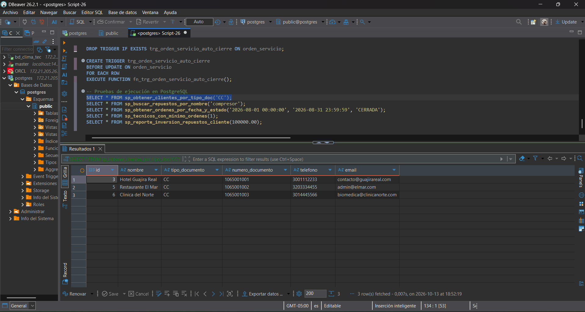
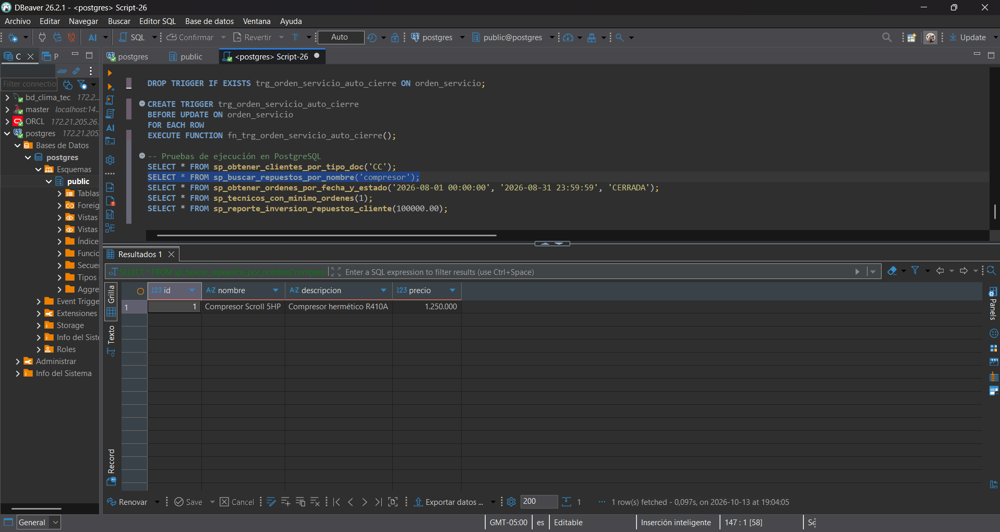
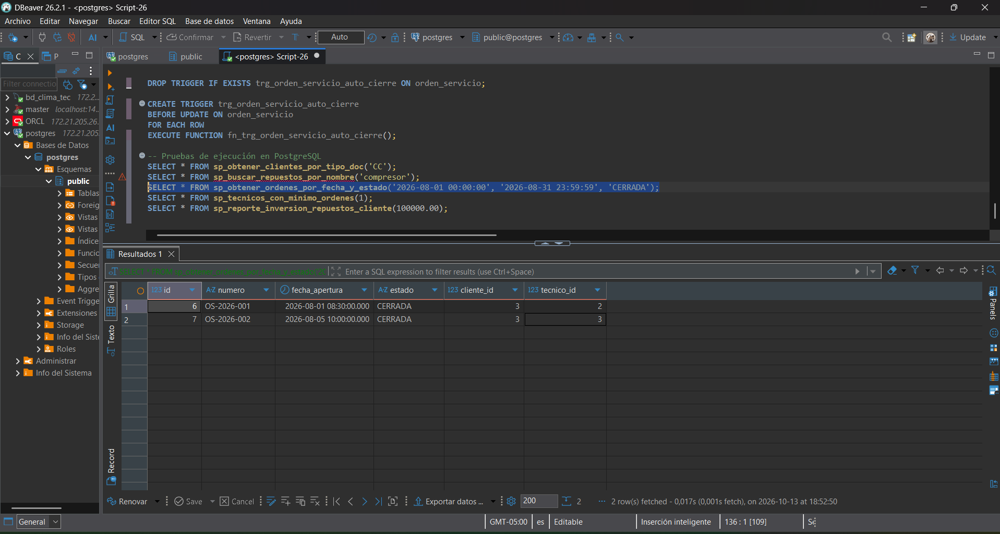
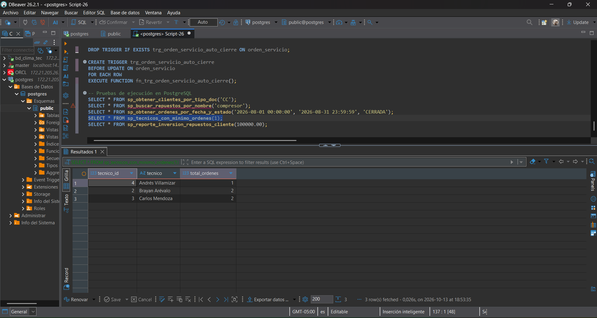
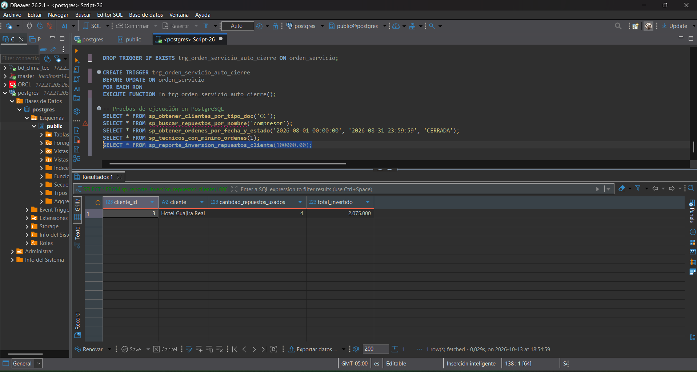

# 📸 Evidencias de Funciones Parametrizadas y Triggers: PostgreSQL (Motor 2)

**Proyecto:** Proyecto 04 - ClimaTec  
**Asignatura:** Base de Datos II  
**Estudiante:** Brayan David Arévalo Luna  
**Motor:** PostgreSQL 17 (`bd_clima_tec`)  

---

## 1. Pruebas de Invocación de Funciones Parametrizadas

### 1.1 Filtrado de Clientes por Tipo de Documento
Invocación de `sp_obtener_clientes_por_tipo_doc('CC')` retornando la lista de clientes filtrados.

---

### 1.2 Búsqueda de Repuestos por Nombre (`ILIKE`)
Invocación de `sp_buscar_repuestos_por_nombre('compresor')` aplicando búsqueda coincidente.

---

### 1.3 Órdenes de Servicio por Fecha y Estado
Invocación de `sp_obtener_ordenes_por_fecha_y_estado('2026-08-01', '2026-08-31', 'CERRADA')`.

---

### 1.4 Técnicos con Mínimo de Órdenes
Invocación de `sp_tecnicos_con_minimo_ordenes(1)` evaluando la carga operativa por técnico.

---

### 1.5 Reporte de Inversión en Repuestos por Cliente
Invocación de `sp_reporte_inversion_repuestos_cliente(100000.00)` agrupando totales por cliente.

