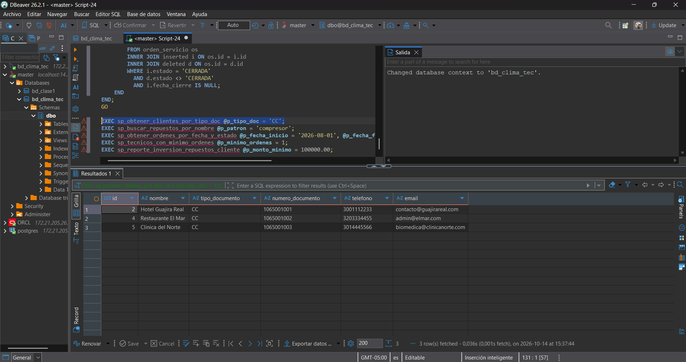
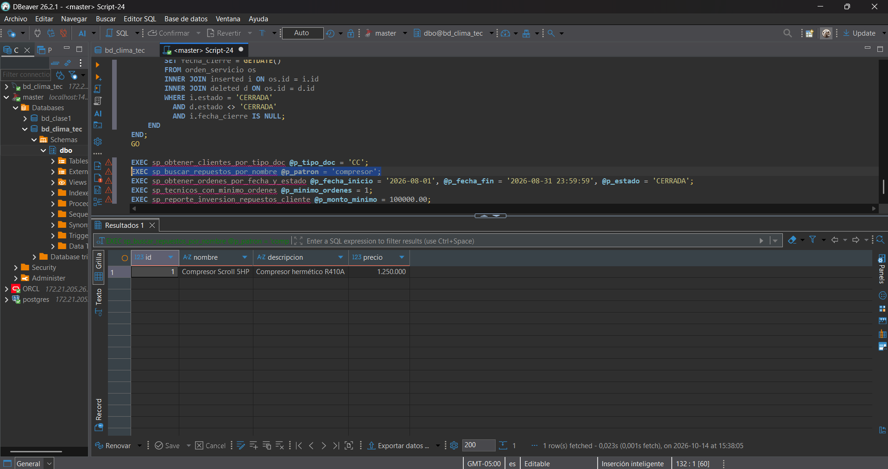
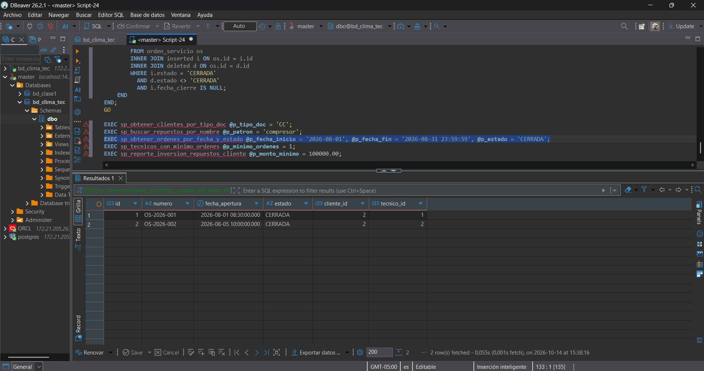
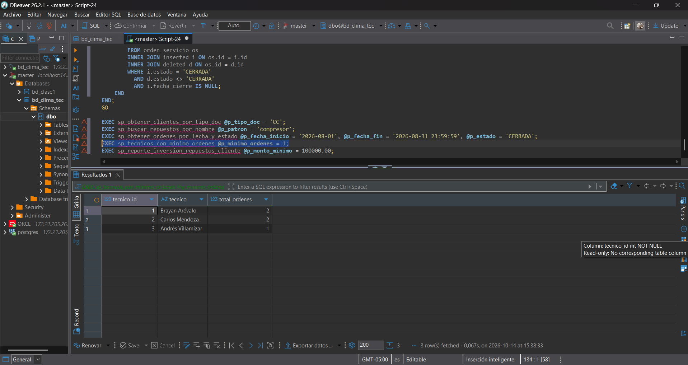
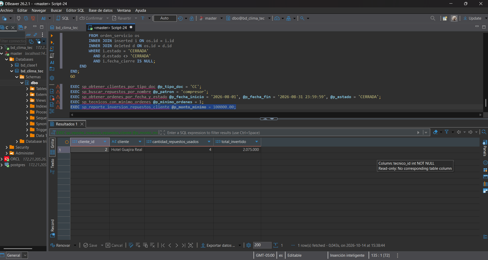

# 📸 Evidencias de Procedimientos Parametrizados y Triggers: SQL Server (Motor 3)

**Proyecto:** Proyecto 04 - ClimaTec  
**Asignatura:** Base de Datos II  
**Estudiante:** Brayan David Arévalo Luna  
**Motor:** MS SQL Server 2022 (`bd_clima_tec`)  

---

## 1. Pruebas de Invocación de Procedimientos Parametrizados (T-SQL)

### 1.1 Filtrado de Clientes por Tipo de Documento
Invocación de `EXEC sp_obtener_clientes_por_tipo_doc @p_tipo_doc = 'CC';`

---

### 1.2 Búsqueda de Repuestos por Nombre (`LIKE`)
Invocación de `EXEC sp_buscar_repuestos_por_nombre @p_patron = 'compresor';`

---

### 1.3 Órdenes de Servicio por Fecha y Estado
Invocación de `EXEC sp_obtener_ordenes_por_fecha_y_estado @p_fecha_inicio = '2026-08-01', @p_fecha_fin = '2026-08-31 23:59:59', @p_estado = 'CERRADA';`

---

### 1.4 Técnicos con Mínimo de Órdenes
Invocación de `EXEC sp_tecnicos_con_minimo_ordenes @p_minimo_ordenes = 1;`

---

### 1.5 Reporte de Inversión en Repuestos por Cliente
Invocación de `EXEC sp_reporte_inversion_repuestos_cliente @p_monto_minimo = 100000.00;`

