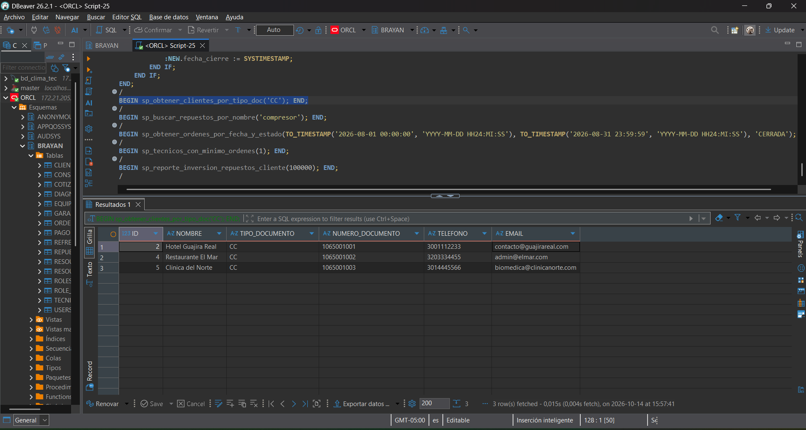
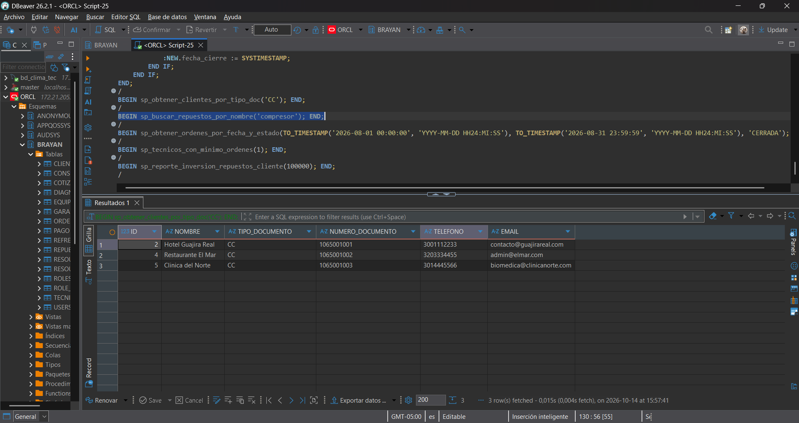
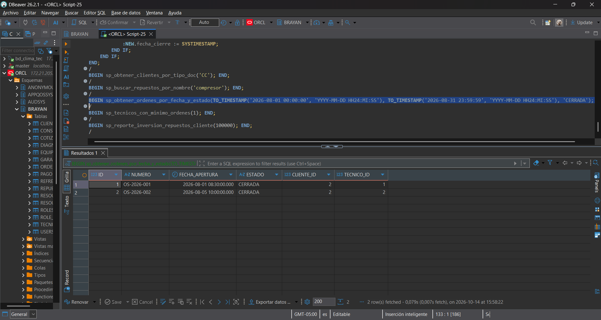
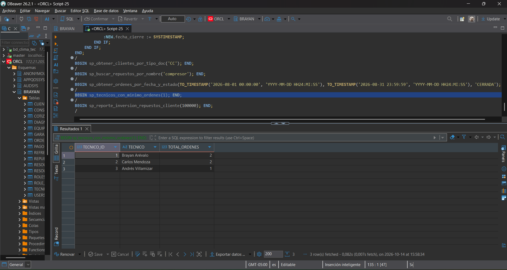
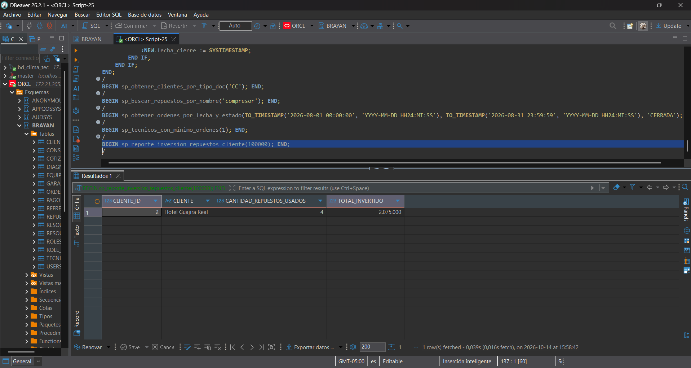

# 📸 Evidencias de Procedimientos Parametrizados y Triggers: Oracle (Motor 4)

**Proyecto:** Proyecto 04 - ClimaTec  
**Asignatura:** Base de Datos II  
**Estudiante:** Brayan David Arévalo Luna  
**Motor:** Oracle Database 21c XE (Esquema `BRAYAN`)  

---

## 1. Pruebas de Invocación de Procedimientos Parametrizados (PL/SQL)

### 1.1 Filtrado de Clientes por Tipo de Documento
Invocación de `BEGIN sp_obtener_clientes_por_tipo_doc('CC'); END;`

---

### 1.2 Búsqueda de Repuestos por Nombre (`UPPER / LIKE`)
Invocación de `BEGIN sp_buscar_repuestos_por_nombre('compresor'); END;`

---

### 1.3 Órdenes de Servicio por Fecha y Estado
Invocación del procedimiento `sp_obtener_ordenes_por_fecha_y_estado` con rango de fechas y estado `'CERRADA'`.

---

### 1.4 Técnicos con Mínimo de Órdenes
Invocación de `BEGIN sp_tecnicos_con_minimo_ordenes(1); END;`

---

### 1.5 Reporte de Inversión en Repuestos por Cliente
Invocación de `BEGIN sp_reporte_inversion_repuestos_cliente(100000); END;`

