# 📸 Evidencias de Backend en Django (Fase I - Business)

**Proyecto:** Proyecto 04 - ClimaTec  
**Asignatura:** Base de Datos II / Backend  
**Estudiante:** Brayan David Arévalo Luna  

---

## 📌 ISS-00: Configuración del Entorno Virtual y Proyecto Base

### 1. Creación del `.venv` e Instalación de Django 5.2.17
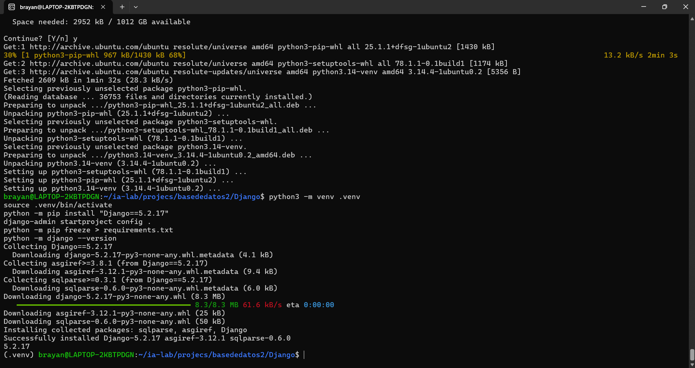

### 2. Edición e Inspección del Script `manage.py`
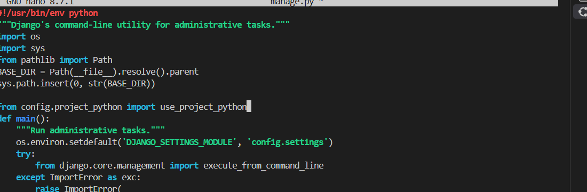

### 3. Configuración de Importación Modular en `manage.py`
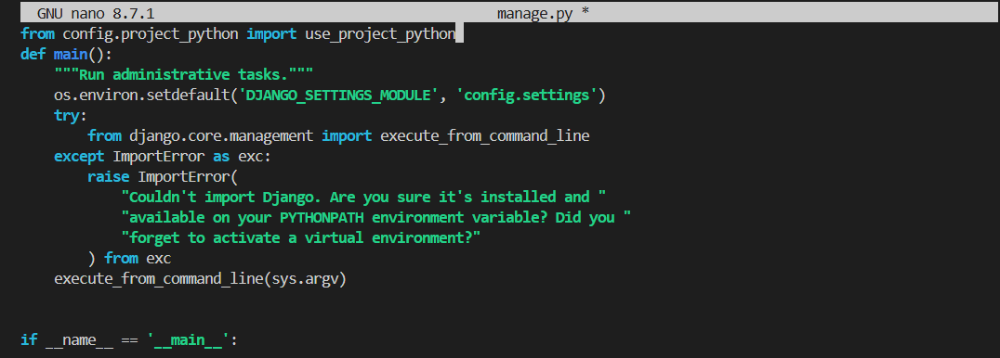

### 4. Ajuste del Punto de Entrada `wsgi.py`
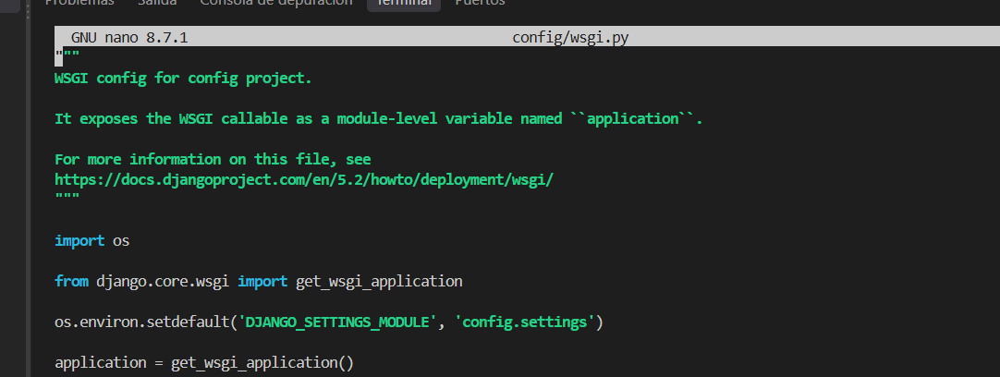

---

## 📌 ISS-01: Ajuste de Settings, `.env` y Conexión Dinámica a Base de Datos

### 5. Definición de Variables de Entorno `.env` para MySQL
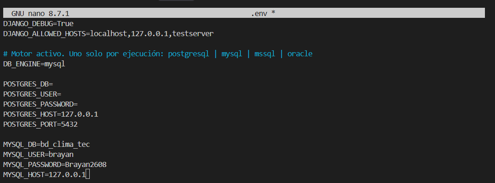

### 6. Diagnóstico y Corrección de Traceback en Migración
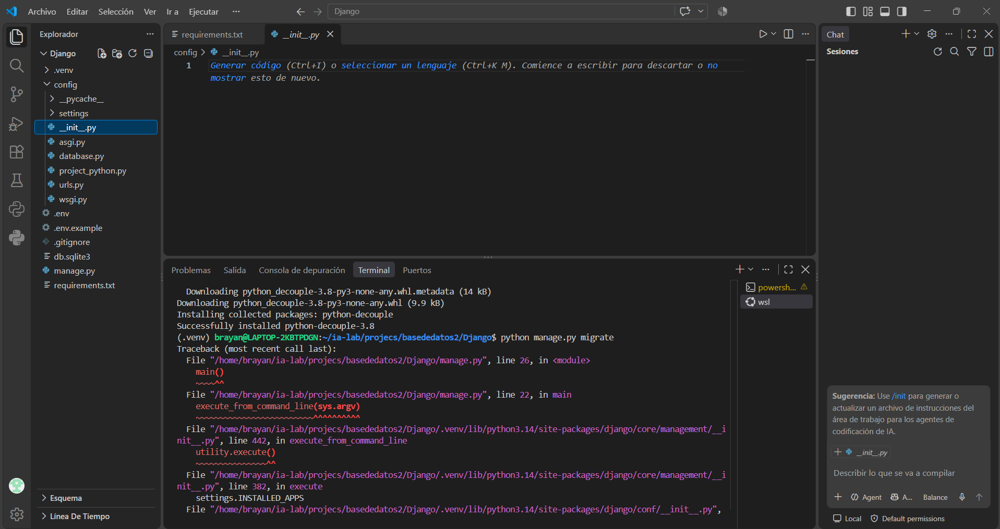

### 7. Integración de `database_from_environ()` en `config/settings/__init__.py`
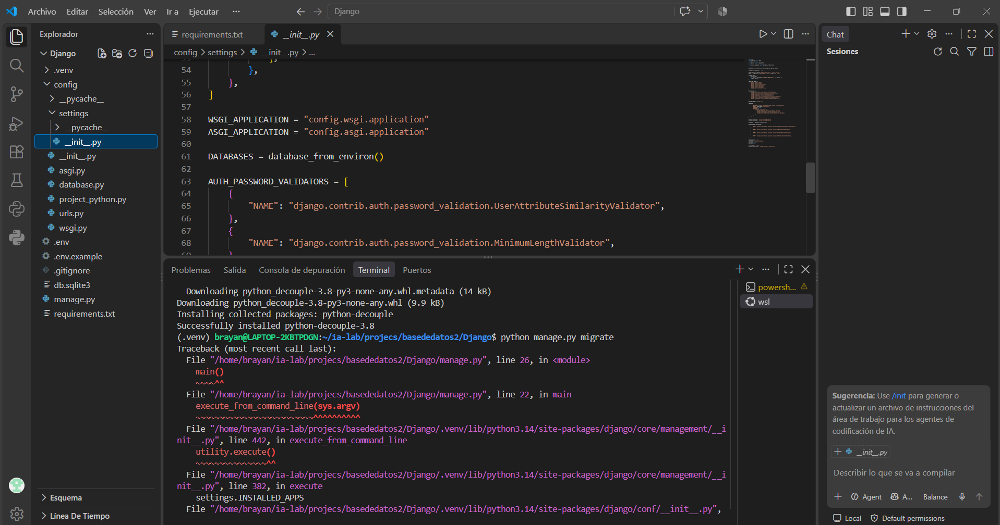

### 8. Corrección del Parámetro Opcional en `config/database.py`
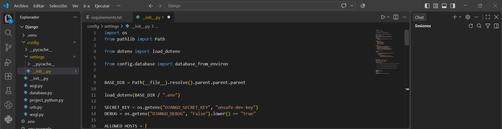

### 9. Ejecución Exitosa de Migraciones Base (`python manage.py migrate`)
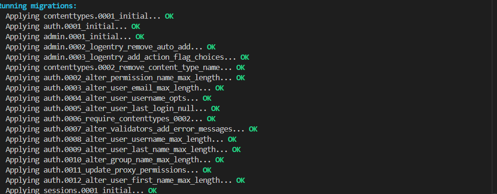

---

## ISS-02: Creación y Registro de Aplicaciones del Negocio

### 10. Limpieza de Módulos Conflictivos y Creación de Apps (`clients`, `products`, `sales`)
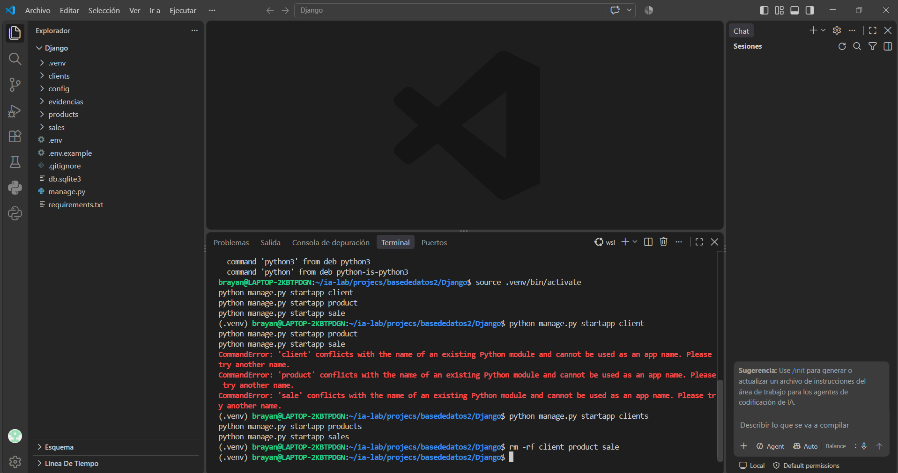

### 11. Registro en `INSTALLED_APPS` y Verificación del Sistema (`python manage.py check`)
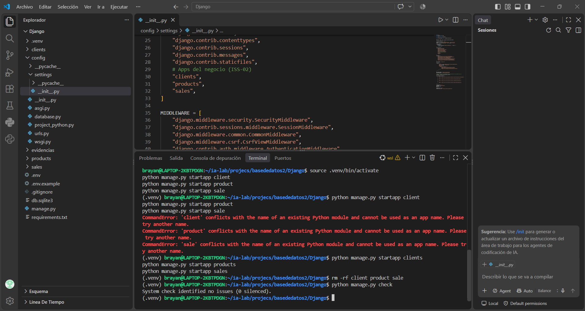

---

## Puntos de Control ISS-03: Modelo de Usuario Personalizado (CustomUser)

### Error de Conflicto en el Historial de Migraciones
Al definir `AUTH_USER_MODEL = "authentication.CustomUser"` en una base de datos donde ya se habian aplicado las migraciones iniciales de Django (`admin`, `auth`, `contenttypes`), se genera el error `InconsistentMigrationHistory`. Esto ocurre debido a que la tabla `admin.0001_initial` intenta ejecutarse antes de la dependencia del modelo de usuario personalizado.

Para resolver este conflicto, se procedio a limpiar el historial borrando la base de datos `bd_clima_tec` en MySQL y recreandola desde cero para garantizar la ejecucion secuencial limpia.

### Inspeccion de la Base de Datos Limpia bd_clima_tec en DBeaver
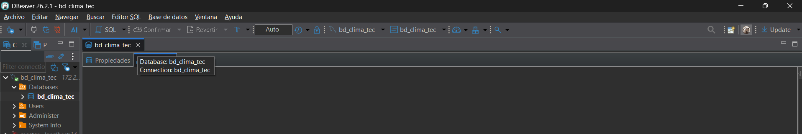

### Definicion de CustomUser y Ejecucion Secuencial Exitosa de Migraciones
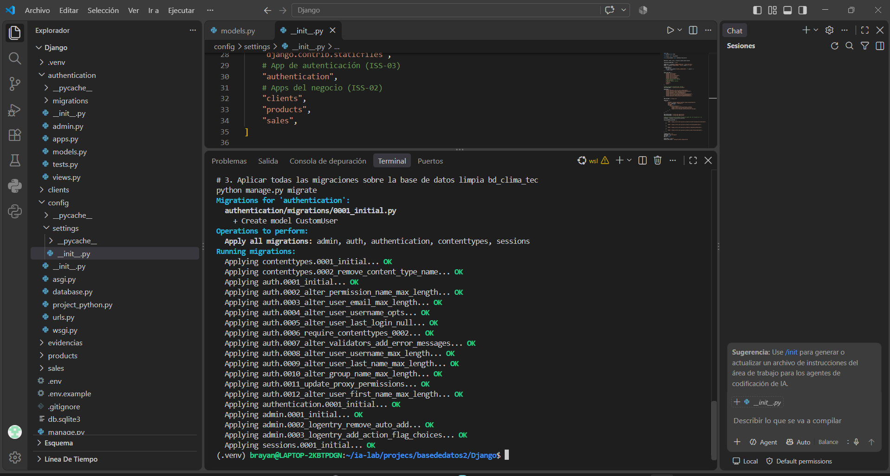
