# 📸 Evidencias de Backend en Django (Fase I - Business)

**Proyecto:** Proyecto 04 - ClimaTec  
**Asignatura:** Base de Datos II / Backend  
**Estudiante:** Brayan David Arévalo Luna  

---

## 📌 ISS-00: Configuración del Entorno Virtual y Proyecto Base

### 1. Creación del `.venv` e Instalación de Django 5.2.17

### 2. Edición e Inspección del Script `manage.py`

### 3. Configuración de Importación Modular en `manage.py`

### 4. Ajuste del Punto de Entrada `wsgi.py`

---

## 📌 ISS-01: Ajuste de Settings, `.env` y Conexión Dinámica a Base de Datos

### 5. Definición de Variables de Entorno `.env` para MySQL

### 6. Diagnóstico y Corrección de Traceback en Migración

### 7. Integración de `database_from_environ()` en `config/settings/__init__.py`

### 8. Corrección del Parámetro Opcional en `config/database.py`

### 9. Ejecución Exitosa de Migraciones Base (`python manage.py migrate`)

---

## ISS-02: Creación y Registro de Aplicaciones del Negocio

### 10. Limpieza de Módulos Conflictivos y Creación de Apps (`clients`, `products`, `sales`)

### 11. Registro en `INSTALLED_APPS` y Verificación del Sistema (`python manage.py check`)

---

## Puntos de Control ISS-03: Modelo de Usuario Personalizado (CustomUser)

### Error de Conflicto en el Historial de Migraciones
Al definir `AUTH_USER_MODEL = "authentication.CustomUser"` en una base de datos donde ya se habian aplicado las migraciones iniciales de Django (`admin`, `auth`, `contenttypes`), se genera el error `InconsistentMigrationHistory`. Esto ocurre debido a que la tabla `admin.0001_initial` intenta ejecutarse antes de la dependencia del modelo de usuario personalizado.

Para resolver este conflicto, se procedio a limpiar el historial borrando la base de datos `bd_clima_tec` en MySQL y recreandola desde cero para garantizar la ejecucion secuencial limpia.

### Inspeccion de la Base de Datos Limpia bd_clima_tec en DBeaver

### Definicion de CustomUser y Ejecucion Secuencial Exitosa de Migraciones

---

## Puntos de Control ISS-04: Modelo Client (Dominio de Clientes)

### Definicion del Modelo Client y Aplicacion de Migracion Inicial
Se definio la estructura relacional del modelo `Client` en `clients/models.py` con sus respectivos campos de identificacion, contacto y marcas de tiempo (`created_at`, `updated_at`). Posteriormente se ejecutaron los comandos `makemigrations clients` y `migrate` para generar e impactar la tabla `clients` en la base de datos MySQL `bd_clima_tec`.

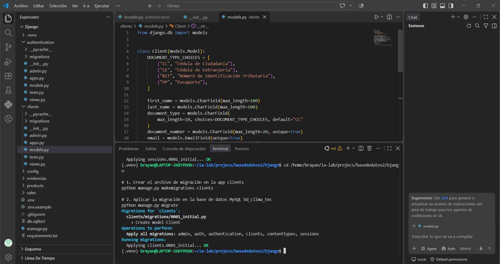

---

## Puntos de Control ISS-05 a ISS-10: Desarrollo de Modelos, Serializers y APIs REST (StoreLab)

### ISS-05: Modelos ProductType y Product
Se definieron los modelos `ProductType` y `Product` en `products/models.py` para la gestion del catalogo de equipos de refrigeracion. Se ejecuto la migracion de forma exitosa en la base de datos MySQL `bd_clima_tec`.

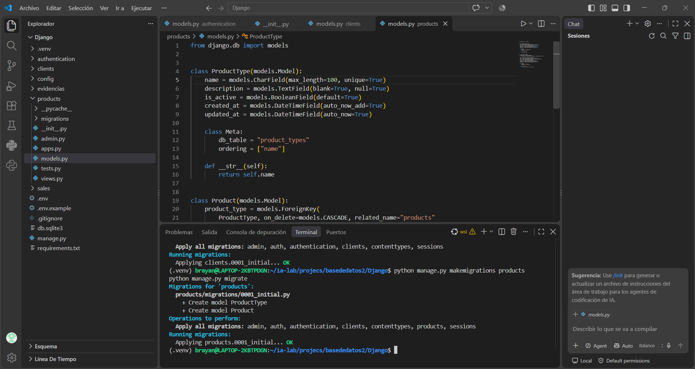

### ISS-06: Modelos Sale y ProductSale
Se implemento la estructura relacional para el registro de ventas e items asociados en `sales/models.py`, aplicando las relaciones de clave foranea correspondientes y migrando los cambios a MySQL.

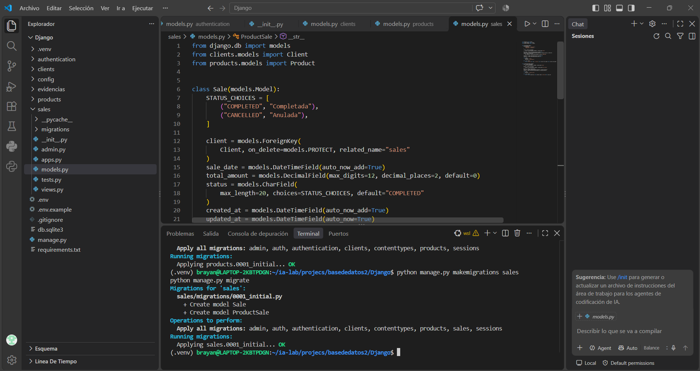

### ISS-07: Configuración de DRF, Serializers y Formato JSON camelCase
Se instalo e integro `djangorestframework` y `djangorestframework-camel-case`, configurando los parsers y renderers en `config/settings/__init__.py`. Se creo el `ClientSerializer` en `clients/serializers.py` verificando el sistema sin errores.

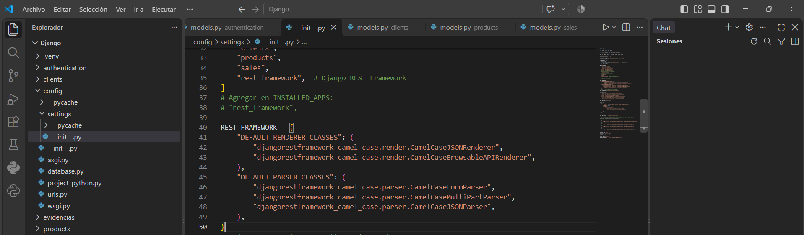
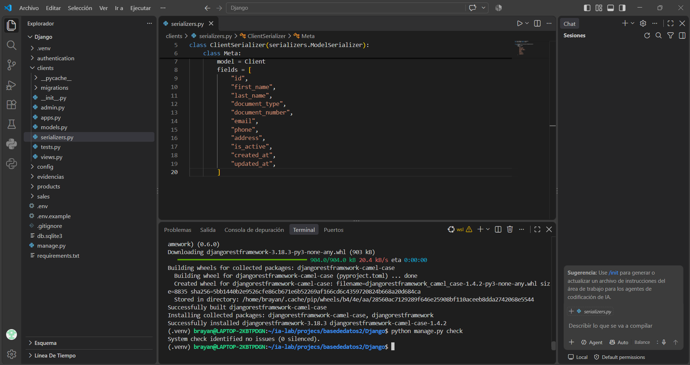

### ISS-08: Rutas y ViewSets para Client (ModelViewSet)
Se desarrollo `ClientViewSet` en `clients/views.py` e integro con `DefaultRouter` en `clients/urls.py` para exponer el CRUD completo de clientes bajo la ruta `/api/v1/clients/`.

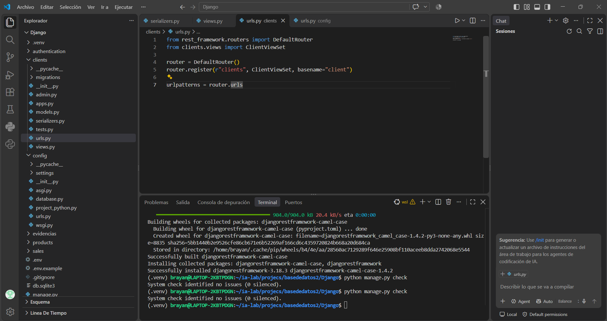

### ISS-09 e ISS-10: API de Catálogo de Productos y Listado de Disponibles
Se crearon los serializers, viewsets y endpoints para `ProductType` y `Product` bajo `/api/v1/product-types/` y `/api/v1/products/`. Asimismo, se implemento la vista `AvailableProductsListView` en `/api/v1/products-available/` para filtrar unicamente productos activos y con stock superior a cero.

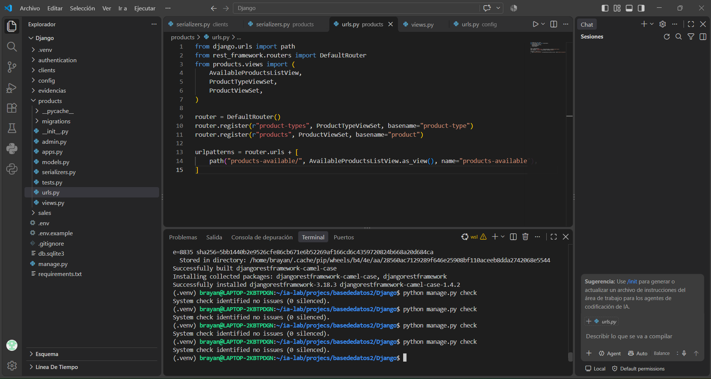

---

## Puntos de Control ISS-11 a ISS-15: Lógica de Negocio Avanzada, Admin, Swagger y Autenticación JWT

### ISS-11: Registro Transaccional de Ventas (APIView)
Se implemento la vista `RegisterSaleAPIView` en `sales/views.py` gestionando la transaccionalidad mediante `@transaction.atomic` para decrementar el stock de productos e insertar cabecera y detalles de venta.

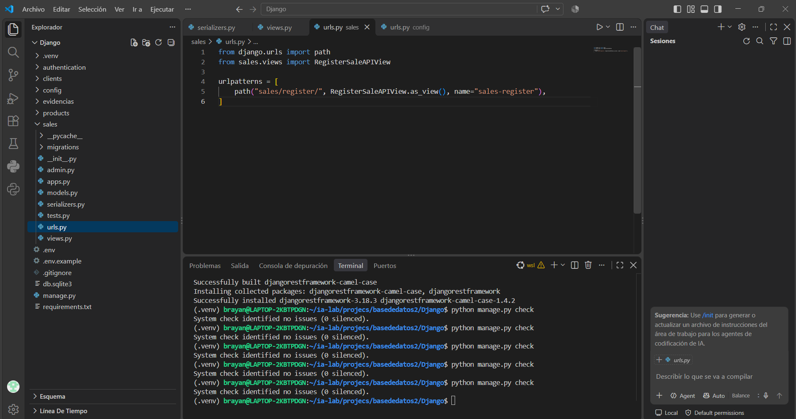

### ISS-12: Consulta y Anulación de Ventas
Se expusieron las vistas de listado/detalle de ventas y el endpoint `CancelSaleAPIView` para anular ventas y reponer las cantidades vendidas al inventario de productos.

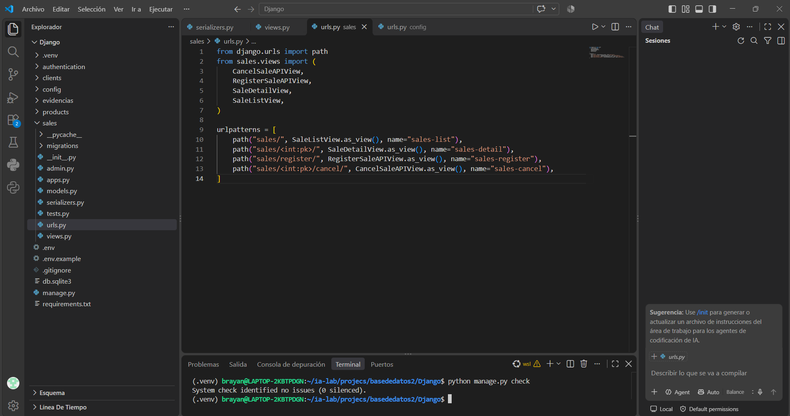

### ISS-13: Configuración e Integración en Django Admin
Se registraron los modelos de `clients`, `products` y `sales` en sus respectivos archivos `admin.py`, habilitando filtros, campos de busqueda y vista inline para items de venta.

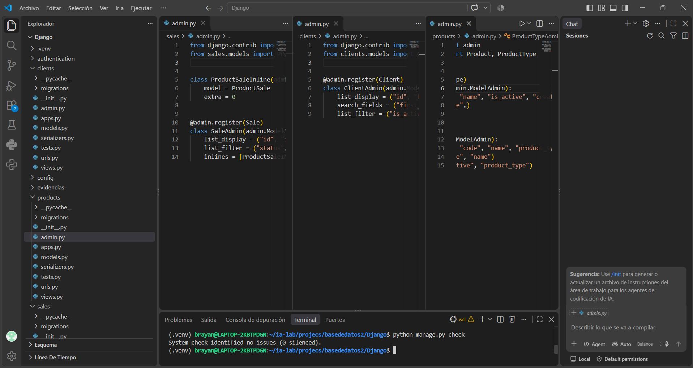

### ISS-14: Documentación OpenAPI e Interfaz Swagger Interactiva
Se integro `drf-spectacular` exponiendo la documentacion de esquemas en `/api/schema/` e interfaz gráfica interactiva en `/api/docs/`.

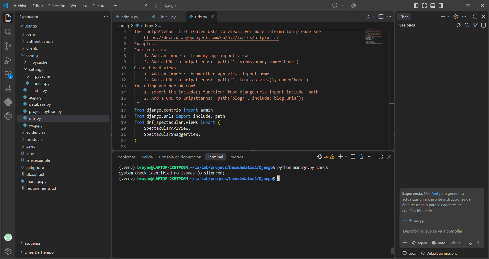

### ISS-15: Autenticación JWT y Resolución de Excepciones de Configuración
Durante la integración de `djangorestframework-simplejwt`, se identificaron dos excepciones de configuración:
1. `TypeError: database_from_environ() missing 1 required positional argument: 'env'`: resuelto pasando explícitamente `os.environ` como argumento a la función de conexion de base de datos en `config/settings/__init__.py`.
2. `ImproperlyConfigured: The SECRET_KEY setting must not be empty.`: resuelto agregando una validacion condicional que asigna una clave de respaldo cuando `DJANGO_SECRET_KEY` se evalua como cadena vacia.

Posteriormente se registraron los endpoints `/api/v1/auth/token/` y `/api/v1/auth/token/refresh/` en `config/urls.py`, obteniendo la verificacion del sistema con 0 errores.

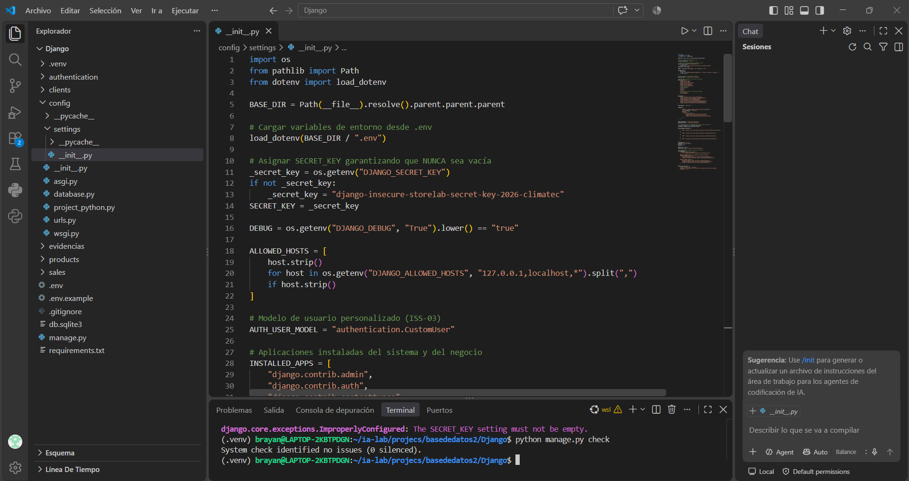
