# Proceso de desarrollo — StoreLab / ClimaTec

Backend académico de **StoreLab**, desarrollado para Base de Datos II con Django y Django REST Framework (DRF). El proceso recorre las ISS-00 a ISS-25: inicia con la configuración del proyecto, construye el dominio de clientes, productos y ventas, y termina con autenticación JWT y autorización RBAC.

**Estudiante:** Brayan David Arévalo Luna<br>
**Docente:** Ing. Jaider Quintero M.<br>
**Periodo:** 2026-II

> Este documento resume qué se construyó, cómo se conectan sus partes y qué conviene explicar en una sustentación. Las capturas y el desarrollo detallado por ISS están en [el índice de evidencias](evidencias/05-django/README.md).

## 1. Objetivo y arquitectura

La aplicación ofrece una API REST para administrar clientes, tipos de producto, productos y ventas. También incluye inicio de sesión JWT, perfil de usuario, permisos basados en roles y documentación OpenAPI.

| Aplicación | Responsabilidad |
| --- | --- |
| `config` | Configuración de Django, selección de base de datos por entorno y rutas principales. |
| `clients` | Modelo, serializer, administración y CRUD de clientes. |
| `products` | Tipos de producto, catálogo, existencias y consulta de productos disponibles. |
| `sales` | Venta y sus detalles; registro transaccional, consulta, anulación y reposición de inventario. |
| `authentication` | Usuario personalizado, roles, asignaciones, recursos protegidos, JWT y permisos RBAC. |

Las relaciones principales son: un cliente puede tener muchas ventas; una venta contiene varios detalles (`ProductSale`); cada detalle referencia un producto. Los precios y subtotales se guardan en el detalle para conservar el valor aplicado al momento de vender.

## 2. Configuración y ejecución

El proyecto requiere Python, las dependencias de `requirements.txt` y un motor de base de datos configurado. La selección del motor se hace con `DB_ENGINE` y las variables del motor elegido; las opciones de conexión están descritas en [.env.example](.env.example).

```bash
python -m venv .venv
source .venv/bin/activate        # Windows: .venv\Scripts\activate
pip install -r requirements.txt
cp .env.example .env             # En PowerShell: Copy-Item .env.example .env
```

Completa `.env` con la clave secreta, el motor, la base de datos, el usuario, la contraseña y el host correspondientes. No publiques `.env` ni credenciales reales. Luego ejecuta:

```bash
python manage.py migrate
python manage.py check
python manage.py runserver
```

La API usa el prefijo `/api/v1/`. Los nombres de campos de la API se representan en camelCase por la integración `djangorestframework-camel-case`; los modelos y el código Python mantienen snake_case.

## 3. Endpoints y flujo de uso

| Recurso | Rutas principales | Para qué sirve |
| --- | --- | --- |
| Clientes | `/api/v1/clients/` | CRUD de clientes mediante `ModelViewSet`. |
| Catálogo | `/api/v1/product-types/`, `/api/v1/products/` | CRUD de tipos y productos. |
| Disponibles | `/api/v1/products-available/` | Lista productos activos que tienen existencias mayores que cero. |
| Ventas | `/api/v1/sales/`, `/api/v1/sales/<id>/`, `/api/v1/sales/register/`, `/api/v1/sales/<id>/cancel/` | Consultar, registrar y anular ventas. |
| Autenticación | `/api/v1/auth/login/`, `/api/v1/auth/token/refresh/`, `/api/v1/auth/logout/`, `/api/v1/auth/me/` | Obtener y renovar tokens, cerrar sesión y consultar el perfil autenticado. |
| Matriz RBAC | `/api/v1/roles/`, `/api/v1/resources/`, `/api/v1/role-users/`, `/api/v1/resource-roles/` | Administrar roles, recursos y sus asignaciones. |
| Esquema y Swagger | `/api/schema/`, `/api/docs/` | Consultar el esquema OpenAPI y explorar la API. |

Para acceder a una ruta protegida, el cliente envía el token de acceso en el encabezado `Authorization: Bearer <access>`. El login personalizado entrega un par de tokens y añade `username` y `email` como claims. El access token dura 60 minutos y el refresh token un día. Al refrescar, se rota el refresh token y el anterior se añade a la lista negra; el logout también invalida el refresh token recibido.

## 4. Recorrido de las ISS y explicación para la sustentación

### Base del proyecto y modelos — ISS-00 a ISS-06

| ISS | Qué se hizo y cómo explicarlo |
| --- | --- |
| **00 — Entorno y proyecto** | Se preparó el entorno virtual y se revisaron los puntos de entrada `manage.py` y WSGI. El entorno virtual mantiene las dependencias del proyecto separadas de las del sistema. |
| **01 — Configuración y base de datos** | Los ajustes viven en `config/settings`; `database_from_environ()` selecciona la conexión usando las variables de entorno. Se corrigió el paso explícito de `os.environ` y se documentó la configuración en `.env.example`. |
| **02 — Aplicaciones Django** | Se separaron las responsabilidades en `authentication`, `clients`, `products` y `sales`, y se registraron en `INSTALLED_APPS`. Esta separación mantiene el dominio y sus endpoints organizados. |
| **03 — Usuario personalizado** | `CustomUser` extiende `AbstractUser`, añade correo único y marcas de tiempo. Se configura con `AUTH_USER_MODEL`; por eso debe definirse antes de aplicar las migraciones iniciales en una base nueva. |
| **04 — Cliente** | `Client` almacena nombres, apellidos, tipo y número de documento, correo, teléfono, dirección, estado y fechas de auditoría. El número de documento y el correo son únicos. |
| **05 — Productos** | `ProductType` clasifica el catálogo y `Product` guarda código, precio, existencias y estado activo, además de su relación con el tipo. |
| **06 — Ventas** | `Sale` representa la cabecera vinculada al cliente; `ProductSale` guarda productos, cantidades, precio unitario y subtotal. Así se pueden relacionar varios productos con una misma venta. |

### API de negocio — ISS-07 a ISS-15

| ISS | Qué se hizo y cómo explicarlo |
| --- | --- |
| **07 — DRF, serializers y camelCase** | DRF convierte entre modelos y JSON mediante serializers. El parser y renderer camelCase aceptan y presentan nombres de campos en ese formato en la API. |
| **08 — API de clientes** | `ClientViewSet` y `DefaultRouter` exponen operaciones CRUD bajo `/api/v1/clients/`, evitando implementar manualmente cada método HTTP. |
| **09 — API del catálogo** | Los viewsets y serializers exponen tipos de producto y productos en `/api/v1/product-types/` y `/api/v1/products/`. |
| **10 — Productos disponibles** | `/api/v1/products-available/` devuelve únicamente productos con `is_active=True` y `stock > 0`. El filtro se realiza en el queryset de Django. |
| **11 — Registro de venta** | El endpoint valida cliente e ítems y usa una transacción atómica: bloquea los productos, verifica que estén activos y tengan existencias suficientes, descuenta stock, crea detalles y calcula el total. Si falla una validación, la transacción revierte todos los cambios. |
| **12 — Consulta y anulación** | Hay endpoints para listar y consultar ventas. La anulación bloquea la venta y los productos, repone las cantidades vendidas y marca la venta como `CANCELLED` en una misma transacción; una venta anulada no se procesa por segunda vez. |
| **13 — Django Admin** | Los modelos de negocio se registraron en el panel administrativo, con columnas, filtros y detalles de venta en línea para facilitar la inspección de datos. |
| **14 — OpenAPI y Swagger** | `drf-spectacular` genera el esquema en `/api/schema/` y la interfaz interactiva en `/api/docs/`. |
| **15 — JWT** | Se integró SimpleJWT y sus rutas para obtener/renovar tokens. La ruta `/api/v1/auth/login/` utiliza el serializer personalizado para agregar claims de usuario. |

### Autenticación y autorización — ISS-16 a ISS-25

| ISS | Qué se hizo y cómo explicarlo |
| --- | --- |
| **16 — Modelos RBAC** | `Role`, `RoleUser`, `Resource` y `ResourceRole` forman la matriz: un usuario puede tener roles y cada rol puede estar asociado a recursos identificados por ruta y método HTTP. |
| **17 — Login y claims** | El serializer de SimpleJWT añade `username` y `email` al access/refresh token. El endpoint abierto de login está en `/api/v1/auth/login/`. |
| **18 — Rotación y blacklist** | Se habilitó `token_blacklist`; al renovar el access token, el refresh se rota y el anterior se invalida. Esto limita la reutilización de refresh tokens ya consumidos. |
| **19 — Logout** | `/api/v1/auth/logout/` recibe un refresh token y lo incluye en la lista negra para cerrar esa sesión. |
| **20 — Perfil** | `/api/v1/auth/me/` devuelve los datos del usuario del token y sus roles. Requiere autenticación y también autorización RBAC para el recurso `GET /api/v1/auth/me/`. |
| **21 — Permiso dinámico** | `HasResourceAccess` comprueba que el usuario autenticado tenga un rol vinculado al recurso cuya ruta y método coinciden con la petición. La consulta usa relaciones que sí existen en los modelos; no depende de supuestos campos `is_active` en las tablas de relación. |
| **22 — Protección de vistas** | Las vistas de clientes, productos y ventas aplican autenticación y `HasResourceAccess`. Primero se identifica al usuario con JWT; luego RBAC decide si alguno de sus roles tiene permiso para ese recurso. |
| **23 — CRUD de la matriz** | Los viewsets de roles, recursos, asignaciones de roles a usuarios y asignaciones de recursos a roles permiten administrar la matriz RBAC a través de la API. |
| **24 — Datos iniciales** | `python manage.py seed_rbac` crea los roles `ADMIN` y `CLIENT`, asigna `ADMIN` al primer usuario si existe y registra el permiso para `GET /api/v1/auth/me/` para ambos roles. Es una semilla mínima: los permisos de otras rutas deben agregarse a la matriz según las necesidades del sistema. |
| **25 — Respuesta sin credenciales** | Se comprobó que una solicitud protegida sin token no obtiene acceso (HTTP 401). La autenticación identifica quién hace la petición; RBAC define qué puede hacer ese usuario. |

## 5. Cómo funciona una venta

1. El cliente envía `clientId` y una lista no vacía de productos con `productId` y `quantity` positiva a `/api/v1/sales/register/`.
   Por ejemplo: `{"clientId": 10, "items": [{"productId": 25, "quantity": 2}]}`
2. El serializer rechaza identificadores o cantidades no positivos y una lista de ítems vacía.
3. Dentro de `transaction.atomic()`, el backend encuentra el cliente y bloquea cada producto con `select_for_update()`. Esto evita que dos ventas simultáneas descuenten la misma existencia disponible.
4. Si el producto no existe, está inactivo o no tiene suficiente stock, se devuelve un error de validación y la transacción no conserva cambios parciales.
5. Si todo es válido, se descuentan las existencias, se guardan los detalles con el precio del momento y se calcula `total_amount`.
6. Al anular, se repone cada cantidad y se cambia el estado a `CANCELLED`. Repetir la anulación se rechaza para evitar devolver stock dos veces.

La transacción hace que venta, detalles e inventario se confirmen juntos o se reviertan juntos. Esta es la idea central que conviene explicar para ISS-11 e ISS-12.

## 6. Comprobaciones y evidencias

Las pruebas automatizadas verifican la consulta RBAC contra el esquema existente, el rechazo de usuarios no autenticados, los filtros de productos disponibles y la validación básica de ítems de venta. Para ejecutar las comprobaciones:

```bash
python manage.py check
python manage.py makemigrations --check --dry-run
python manage.py test
```
### Evidencias

### ISS-00 a ISS-04 — Entorno, configuración y cliente

**ISS-00: entorno virtual y estructura de Django**


**ISS-01: variables de entorno, conexión y migraciones**


**ISS-02 a ISS-04: aplicaciones, usuario y cliente**


### ISS-05 a ISS-15 — Dominio, API, ventas, admin y JWT


### ISS-16 a ISS-25 — Autenticación, RBAC y seguridad

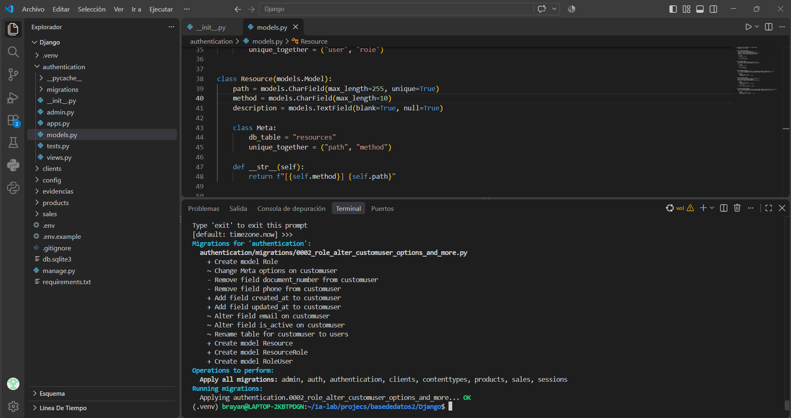
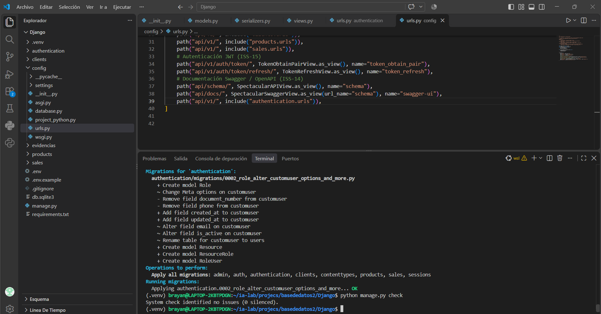
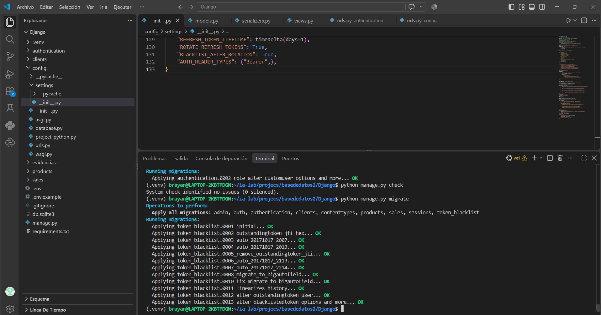
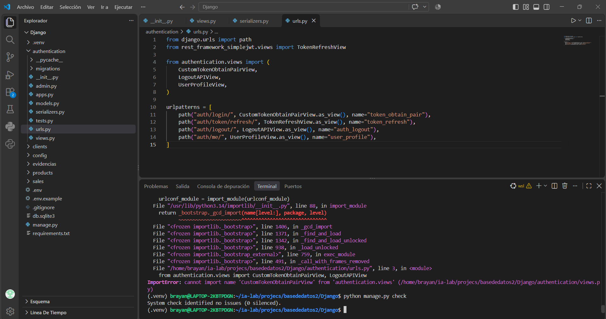
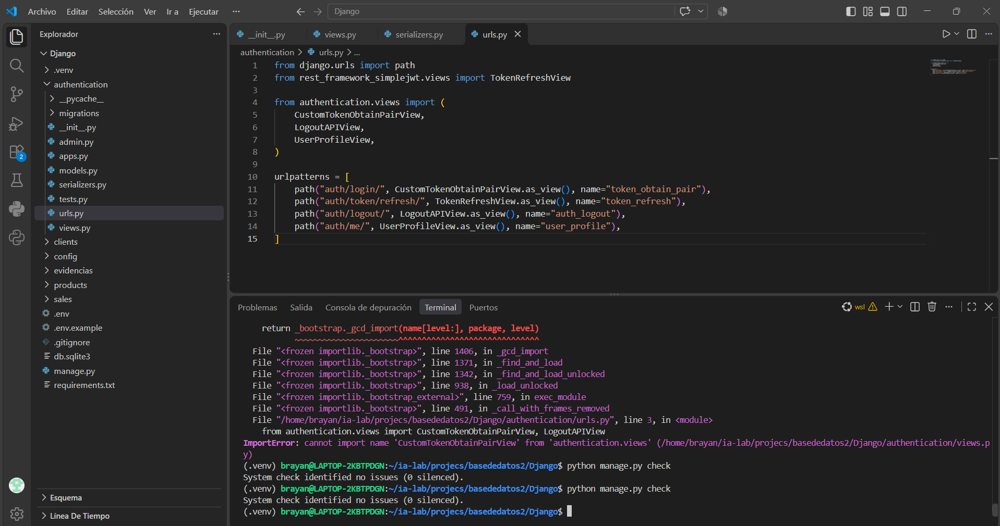
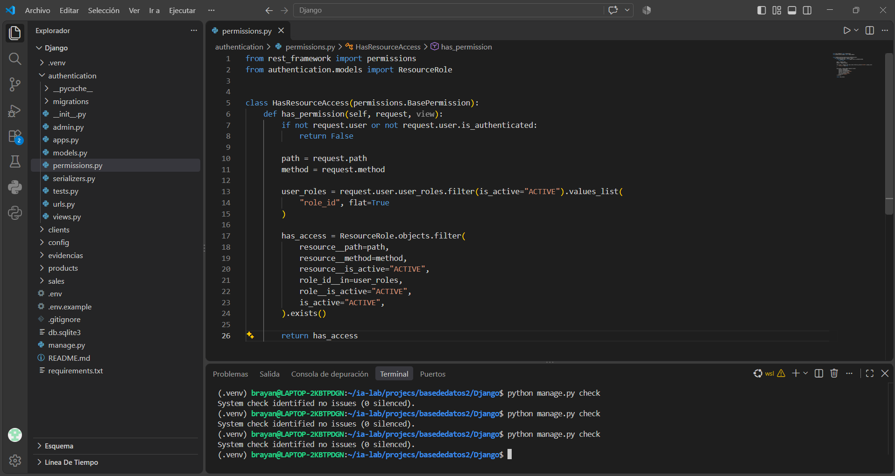
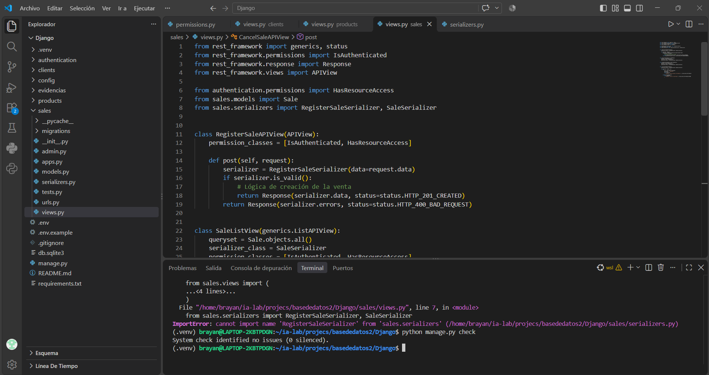
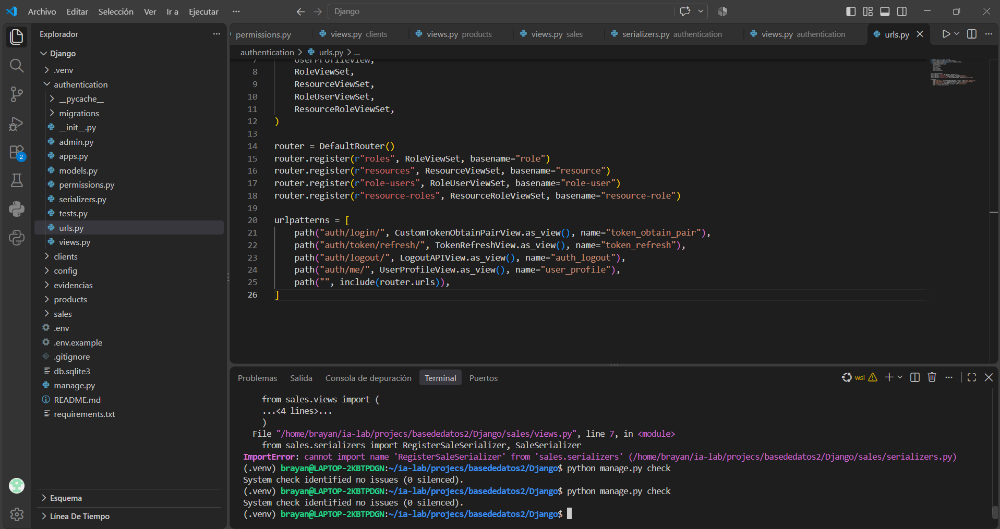
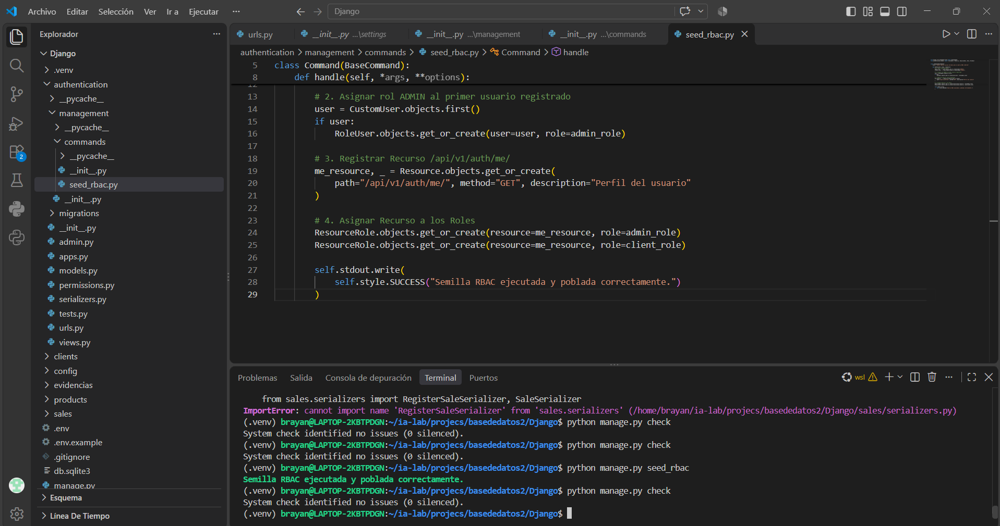
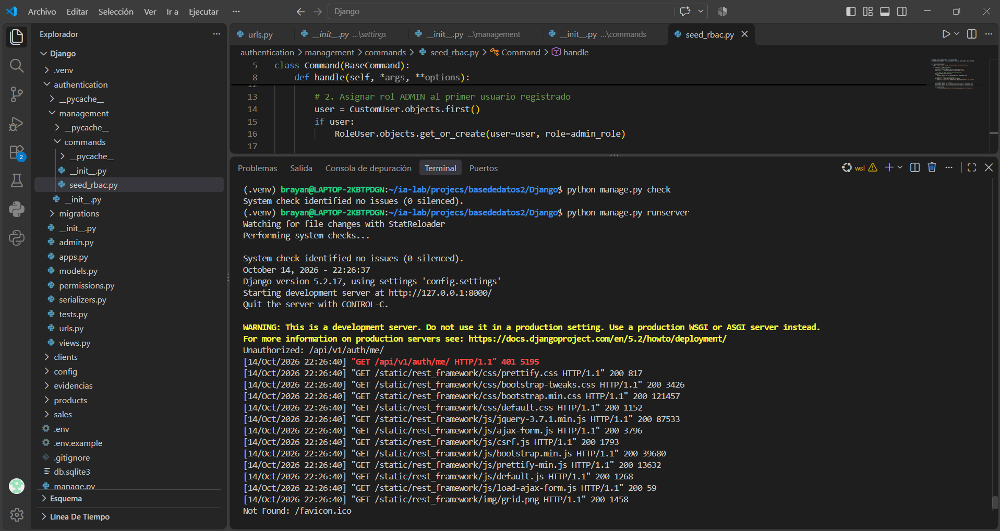
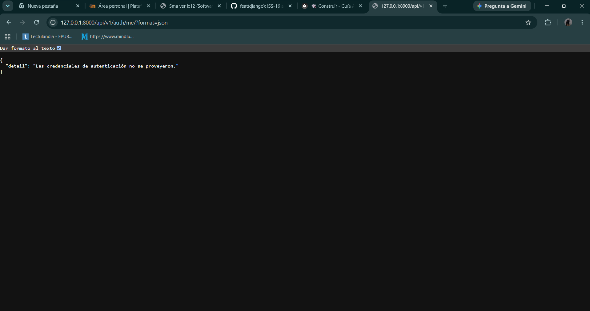
